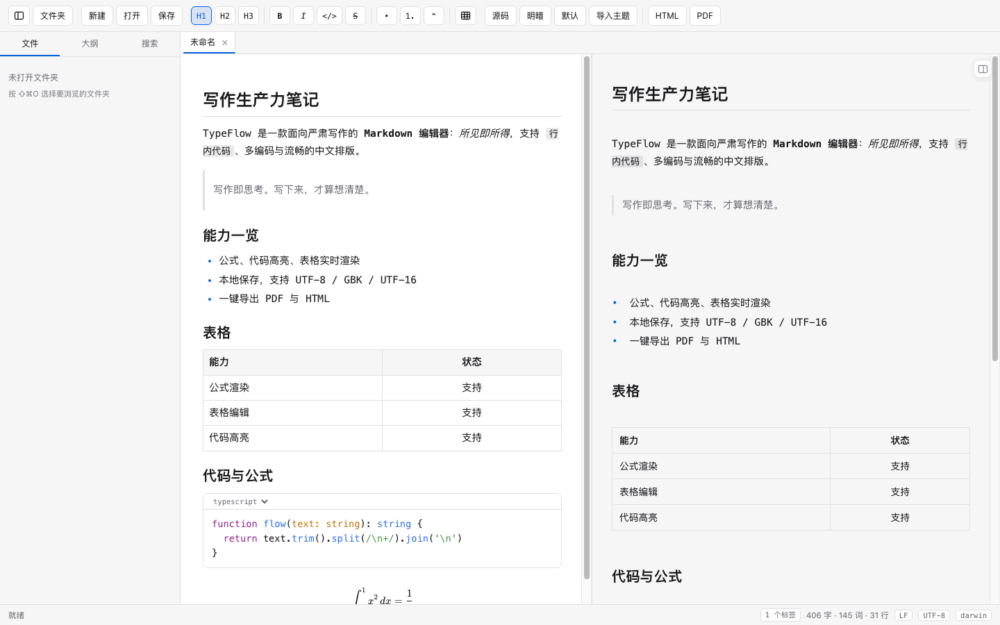

# TypeFlow

本地优先的 Markdown 编辑器：所见即所得与源码双模式、公式、代码高亮、表格、图片粘贴、PDF / HTML 导出。

**免费开源（MIT）** ｜ macOS ｜ Electron + ProseMirror



## 功能

| 能力 | 说明 |
|---|---|
| 双模式编辑 | 所见即所得 ⇄ 源码，一键切换（⇧⌘M） |
| Markdown | 标题、列表、引用、代码块、表格、链接、图片、删除线 |
| 输入即渲染 | `# ` `- ` `1. ` `> ` ` ``` ` `---` `**粗体**` `*斜体*` `` `代码` `` `~~删除~~` |
| 公式 | 行内 `$...$` 与块级 `$$...$$`（KaTeX） |
| 代码高亮 | 14 种语言，块内可下拉切换语言 |
| 表格 | 支持列对齐（`:---` / `:--:` / `---:`） |
| 图片 | 粘贴后自动保存到文档同目录 `assets/`，写入相对路径 |
| 预览 | 分屏 / 仅编辑 / 仅预览（⇧⌘V），双向联动滚动 |
| 导出 | PDF（自包含，字体与图片内嵌）、HTML（单文件，图片内联） |
| 工作区 | 文件树、多标签、全局搜索、大纲导航 |
| 编码 | UTF-8 / UTF-16 / GBK 自动识别；GBK 以只读方式打开，避免保存损坏 |
| 纯文本 | `.txt` 恒为源码模式，逐字保存，不做格式转换 |
| 只读查看 | PDF、HTML 与图片（不加载编辑内核，无编辑入口） |
| 界面 | 中英双语、明暗配色、排版主题、可导入自定义主题 CSS |
| 隐私 | 完全本地，不联网、不收集、不上传 |

## 下载安装

到 [Releases](../../releases) 下载最新的 zip：

- Apple Silicon（M 系列）：`TypeFlow-<版本>-arm64-mac.zip`
- Intel：`TypeFlow-<版本>-x64-mac.zip`

解压后把 `TypeFlow.app` 拖进「应用程序」。

### 首次打开被 macOS 拦住？

这个应用**没有做代码签名与公证**（需要 $99/年 的 Apple 开发者会员，本项目不做），
所以首次打开会遇到「无法验证开发者」或「已损坏」。三种办法任选：

1. **右键点击** `TypeFlow.app` → 选择「打开」→ 在弹窗中再点一次「打开」
2. **移除隔离标记**（等价于告诉系统"这个文件我信任"）：

   ```bash
   xattr -dr com.apple.quarantine /Applications/TypeFlow.app
   ```

3. **系统设置 → 隐私与安全性 → 底部「仍要打开」**
   （先双击一次让系统弹出拦截，再回设置里放行）

第 3 种最稳妥，也最不容易被系统"记住"成可疑文件。

### 自己编译（不需要绕过 Gatekeeper）

```bash
npm install      # 需要 Node 20+
npm run build
npm run pack:open
```

自己编译出来的应用没有 quarantine 标记，打开不会拦。
依赖下载遇到问题的处理方式见 [开发者文档](docs/DEVELOPMENT.md#环境问题)。

## 快捷键

| 操作 | 快捷键 |
|---|---|
| 新建 / 打开 / 保存 / 另存为 | ⌘N / ⌘O / ⌘S / ⇧⌘S |
| 打开文件夹 / 关闭标签 | ⇧⌘O / ⌘W |
| 显示隐藏侧边栏 | ⌘B |
| 工作区搜索 | ⇧⌘F |
| 刷新文件树 | ⌘R |
| 撤销 / 重做 | ⌘Z / ⇧⌘Z |
| 加粗 / 斜体 / 行内代码 / 删除线 | ⌘B / ⌘I / ⌘E / ⇧⌘X |
| 标题 1–6 | ⌥⌘1 … ⌥⌘6 |
| 正文 | ⌘0 |
| 列表缩进 / 反缩进 | Tab / ⇧Tab |
| 查找 | ⌘F |
| 切换所见即所得 / 源码 | ⇧⌘M |
| 切换布局 | ⇧⌘V |
| 切换主题 | ⇧⌘L |

布局三态：**分屏 / 仅编辑区 / 仅预览**，用菜单「视图 → 切换布局」（⇧⌘V）循环切换；
分屏下编辑区与预览区双向联动滚动。

## 许可证

[MIT](LICENSE) © 2026 Mirror吕洪磊

第三方依赖保持各自许可证：ProseMirror（MIT）、KaTeX（MIT）、highlight.js（BSD-3-Clause）、
pdf.js（Apache-2.0）、markdown-it（MIT）。

---

技术细节、验证体系与构建说明见 [docs/DEVELOPMENT.md](docs/DEVELOPMENT.md)。
